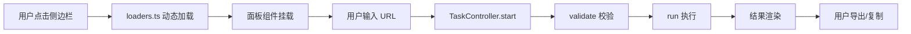

# 新面板开发指南

> 灵眸 v6 — 面板快速开发与集成
> 
> 本指南帮助贡献者快速理解灵眸架构，从零开始创建一个功能完整的面板。

## 目录

1. [架构概览](#架构概览)
2. [创建新面板](#创建新面板)
3. [注册面板](#注册面板)
4. [集成 TaskController](#集成-taskcontroller)
5. [结果展示与交互](#结果展示与交互)
6. [测试与调试](#测试与调试)
7. [最佳实践](#最佳实践)

---

## 架构概览

### 核心概念

```
用户交互 → 面板组件 → TaskController → 业务逻辑 → 结果渲染
            ↓                              ↓
        registry.ts                   background.ts
```

**关键文件：**

- `src/panels/registry.ts` — 面板元数据注册（侧边栏、搜索、快捷入口）
- `src/panels/loaders.ts` — 面板懒加载（动态 import，自动代码分割）
- `src/lib/tasks/task-controller.ts` — 统一任务状态机（运行/暂停/取消）
- `src/components/results/` — 通用结果展示组件（ResponsiveTable、EmptyState）
- `entrypoints/background.ts` — 后台消息处理（跨域请求、存储、Tab API）

### 面板生命周期



---

## 创建新面板

### 1. 创建面板目录

```bash
mkdir -p src/panels/my-panel
touch src/panels/my-panel/MyPanel.svelte
```

### 2. 面板模板

最小可用面板（无 TaskController）：

```svelte
<script lang="ts">
  // MyPanel.svelte — 示例面板
  import { toastStore } from '@/stores/ui';
  import { getActiveTabUrl } from '@/lib/core/tabs';
  
  let targetUrl = $state('');
  let result = $state('');

  async function autoFill() {
    const url = await getActiveTabUrl();
    if (url) targetUrl = url;
  }

  function analyze() {
    if (!targetUrl.trim()) {
      toastStore.show('请输入 URL', 'warning');
      return;
    }
    // 实现你的业务逻辑
    result = `分析结果：${targetUrl}`;
    toastStore.show('分析完成', 'success');
  }
</script>

<div class="panel">
  <div class="panel-header">
    <h2 class="panel-title">我的面板</h2>
  </div>

  <div class="panel-body space-y-3">
    <!-- URL 输入 -->
    <div class="space-y-1.5">
      <label class="label">目标 URL</label>
      <div class="flex gap-2">
        <input
          type="text"
          class="input flex-1"
          placeholder="https://example.com"
          bind:value={targetUrl}
        />
        <button type="button" class="btn btn-secondary" onclick={autoFill}>
          自动填充
        </button>
      </div>
    </div>

    <!-- 操作按钮 -->
    <button type="button" class="btn btn-primary" onclick={analyze}>
      开始分析
    </button>

    <!-- 结果显示 -->
    {#if result}
      <div class="card p-3">
        <p>{result}</p>
      </div>
    {/if}
  </div>
</div>
```

---

## 注册面板

### 1. 在 `registry.ts` 注册元数据

```typescript
// src/panels/registry.ts
export const panelMeta: PanelMeta[] = [
  // ... 已有面板
  {
    id: 'my-panel',
    label: '我的面板',
    icon: '🔧',
    category: 'tool',
    categoryLabel: '工具',
    catColor: '#10B981',
    aliases: ['自定义', 'custom'],
    keywords: ['分析', '检测', 'analyze'],
    capabilities: ['target-url', 'copy', 'export'],
    supportsAutoRun: true,
  },
];
```

**字段说明：**

- `id` — 唯一标识符（与懒加载 key 对应）
- `label` — 侧边栏显示名称
- `icon` — Emoji 图标
- `category` — 分类 ID（recon/attack/tool/framework）
- `categoryLabel` — 分类中文名
- `catColor` — 分类颜色（十六进制）
- `aliases` — 搜索别名（中英文）
- `keywords` — 搜索关键词
- `capabilities` — 面板能力标签（见下方）
- `supportsAutoRun` — 是否支持 Popup 快捷运行

**能力标签（capabilities）：**

| 标签 | 说明 | 示例 |
|------|------|------|
| `target-url` | 接收目标 URL | UrlInput 组件 |
| `task` | 接入 TaskController | 可暂停/取消 |
| `filter` | 结果可筛选 | ResultToolbar |
| `export` | 结果可导出 | ExportMenu |
| `copy` | 结果可复制 | 复制按钮 |
| `history` | 写入历史记录 | scan-history store |
| `handoff` | 跨面板数据交接 | analysisContextStore |

### 2. 在 `loaders.ts` 添加懒加载

```typescript
// src/panels/loaders.ts
export const panelLoaders: Record<string, PanelLoader> = {
  // ... 已有面板
  'my-panel': () => import('./my-panel/MyPanel.svelte'),
};
```

**验证注册：**

1. 启动开发服务器：`pnpm dev`
2. 打开侧边栏，搜索「我的面板」
3. 点击面板，应看到组件正常渲染

---

## 集成 TaskController

### 为什么需要 TaskController？

TaskController 提供：

- ✅ 统一状态机（idle → validating → running → succeeded/failed）
- ✅ 暂停/恢复/取消（AbortController 传播）
- ✅ 进度上报（completed/total/phase）
- ✅ 错误处理（ActionableError 规范）
- ✅ 重试逻辑（retry 'all' / 'failed'）

### 集成步骤

#### 1. 定义 Adapter

```typescript
// src/lib/scanners/my-scanner.ts
import type { TaskAdapter, TaskRunContext } from '@/lib/tasks/task-controller';
import { sendMessage } from '@/lib/core/messaging';

export interface MyInput {
  url: string;
  options?: Record<string, unknown>;
}

export interface MyResult {
  findings: Array<{ title: string; severity: string }>;
  summary: string;
}

export const myAdapter: TaskAdapter<MyInput, MyResult> = {
  async validate(input) {
    if (!input.url.trim()) {
      throw new Error('URL 不能为空');
    }
    // 更多校验逻辑...
  },

  async run(input, ctx) {
    const findings: Array<{ title: string; severity: string }> = [];
    
    // 示例：模拟扫描进度
    const steps = ['检测框架', '分析路由', '提取配置'];
    for (let i = 0; i < steps.length; i++) {
      // 检查取消信号
      if (ctx.signal.aborted) break;
      
      // 上报进度
      ctx.reportProgress({
        phase: steps[i],
        completed: i + 1,
        total: steps.length,
      });

      // 模拟异步工作
      const result = await sendMessage({
        type: 'FETCH_URL',
        url: input.url,
      });

      if (result.success) {
        findings.push({
          title: `发现 ${steps[i]}`,
          severity: 'info',
        });
      }
      
      await new Promise(r => setTimeout(r, 500));
    }

    return {
      findings,
      summary: `扫描完成，发现 ${findings.length} 项`,
    };
  },
};
```

#### 2. 在面板中使用

```svelte
<script lang="ts">
  import { createTaskController } from '@/lib/tasks/task-controller';
  import { myAdapter, type MyInput } from '@/lib/scanners/my-scanner';
  import ScanProgress from '@/components/results/ScanProgress.svelte';
  import EmptyState from '@/components/results/EmptyState.svelte';
  
  let targetUrl = $state('');
  
  // 创建任务控制器
  const ctrl = createTaskController(myAdapter, {
    canPause: true,
    centerPanel: 'my-panel',
    centerLabel: '我的面板',
  });
  
  const st = $derived($ctrl.state);
  
  async function startScan() {
    const input: MyInput = { url: targetUrl.trim() };
    const { status, result } = await ctrl.start(input);
    
    if (status === 'succeeded' && result) {
      console.log('扫描成功:', result);
    }
  }
  
  // 组件销毁时清理
  $effect(() => {
    return () => ctrl.dispose();
  });
</script>

<div class="panel">
  <div class="panel-header">
    <h2 class="panel-title">我的面板</h2>
  </div>

  <div class="panel-body space-y-3">
    <!-- URL 输入 -->
    <div class="space-y-1.5">
      <label class="label">目标 URL</label>
      <input
        type="text"
        class="input"
        bind:value={targetUrl}
        disabled={st.status === 'running' || st.status === 'paused'}
      />
    </div>

    <!-- 进度显示 -->
    {#if st.status === 'running' || st.status === 'paused'}
      <ScanProgress {ctrl} />
    {/if}

    <!-- 操作按钮 -->
    {#if st.status === 'idle'}
      <button type="button" class="btn btn-primary" onclick={startScan}>
        开始扫描
      </button>
    {:else if st.status === 'running'}
      <div class="flex gap-2">
        {#if st.canPause}
          <button type="button" class="btn btn-secondary" onclick={() => ctrl.pause()}>
            暂停
          </button>
        {/if}
        <button type="button" class="btn btn-secondary" onclick={() => ctrl.cancel()}>
          取消
        </button>
      </div>
    {:else if st.status === 'paused'}
      <div class="flex gap-2">
        <button type="button" class="btn btn-primary" onclick={() => ctrl.resume()}>
          继续
        </button>
        <button type="button" class="btn btn-secondary" onclick={() => ctrl.cancel()}>
          取消
        </button>
      </div>
    {:else if st.status === 'succeeded' || st.status === 'failed'}
      <button type="button" class="btn btn-secondary" onclick={() => ctrl.reset()}>
        重新扫描
      </button>
    {/if}

    <!-- 错误提示 -->
    {#if st.error}
      <EmptyState
        title="扫描失败"
        description={st.error.message}
        icon="❌"
      />
    {/if}
  </div>
</div>
```

---

## 结果展示与交互

### 使用 ResponsiveTable

```svelte
<script lang="ts">
  import ResponsiveTable, { type Col } from '@/components/results/ResponsiveTable.svelte';
  
  interface Finding {
    title: string;
    severity: 'low' | 'medium' | 'high';
    description: string;
  }
  
  const findings: Finding[] = $state([]);
  
  const cols: Col[] = [
    { key: 'title', header: '标题', primary: true },
    { key: 'severity', header: '严重程度', hideUnder: 640 },
    { key: 'description', header: '描述', hideUnder: 768 },
  ];
  
  function severityClass(sev: string): string {
    if (sev === 'high') return 'text-red-500';
    if (sev === 'medium') return 'text-yellow-500';
    return 'text-blue-500';
  }
</script>

<ResponsiveTable
  {cols}
  rows={findings}
  pagination={true}
  rowKey={(r, i) => `${r.title}-${i}`}
>
  {#snippet cell(col, row)}
    {#if col.key === 'severity'}
      <span class={severityClass(row.severity)}>{row.severity.toUpperCase()}</span>
    {:else}
      {row[col.key as keyof Finding]}
    {/if}
  {/snippet}
</ResponsiveTable>
```

**虚拟滚动（千行级场景）：**

```svelte
<ResponsiveTable
  {cols}
  rows={findings}
  pagination={{ virtual: true }}
  rowKey={(r, i) => `${r.title}-${i}`}
>
  {#snippet cell(col, row)}
    <!-- ... -->
  {/snippet}
</ResponsiveTable>
```

### 使用 EmptyState

```svelte
<script lang="ts">
  import EmptyState from '@/components/results/EmptyState.svelte';
</script>

{#if findings.length === 0}
  <EmptyState
    title="暂无结果"
    description="输入 URL 并点击「开始扫描」"
    icon="🔍"
  />
{/if}
```

### 结果导出

```svelte
<script lang="ts">
  import { downloadJson, buildFilename } from '@/lib/actions/download';
  import ExportMenu from '@/components/results/ExportMenu.svelte';
  
  function exportResults() {
    const filename = buildFilename('my-panel', 'json');
    downloadJson(findings, filename);
  }
</script>

<ExportMenu onExport={exportResults} formats={['json']} />
```

---

## 测试与调试

### 单元测试

```typescript
// src/lib/scanners/my-scanner.test.ts
import { describe, it, expect, vi } from 'vitest';
import { myAdapter } from './my-scanner';

describe('myAdapter', () => {
  it('should validate empty URL', async () => {
    await expect(myAdapter.validate!({ url: '' })).rejects.toThrow('URL 不能为空');
  });

  it('should run scan successfully', async () => {
    const mockCtx = {
      signal: new AbortController().signal,
      taskId: 1,
      isCurrent: () => true,
      isPaused: () => false,
      reportProgress: vi.fn(),
    };

    const result = await myAdapter.run({ url: 'https://example.com' }, mockCtx);
    expect(result.findings).toBeDefined();
    expect(mockCtx.reportProgress).toHaveBeenCalled();
  });
});
```

运行测试：

```bash
pnpm test src/lib/scanners/my-scanner.test.ts
```

### 调试技巧

1. **查看后台消息日志**

```typescript
// entrypoints/background.ts
console.log('[Background] 收到消息:', message);
```

2. **监听任务状态变化**

```svelte
<script lang="ts">
  $effect(() => {
    console.log('任务状态:', $ctrl.state);
  });
</script>
```

3. **使用浏览器 DevTools**

- 右键扩展图标 → 检查弹出内容（Popup）
- chrome://extensions → 背景页（Service Worker）
- F12 打开侧边栏 DevTools

---

## 最佳实践

### 1. URL 校验

始终使用 `url-guard` 防止 SSRF：

```typescript
import { validateProbeUrl } from '@/lib/core/url-guard';

const validated = validateProbeUrl(url);
if ('error' in validated) {
  throw new Error(`无效 URL: ${validated.error}`);
}
const safeUrl = validated.parsed.href;
```

### 2. 并发控制

使用 `runConcurrent` 限制并发数：

```typescript
import { runConcurrent } from '@/lib/core/concurrency';

await runConcurrent(
  urls,
  async (url, idx) => {
    ctx.reportProgress({ completed: idx + 1, total: urls.length });
    await processUrl(url);
  },
  {
    concurrency: 5,
    cancelled: () => ctx.signal.aborted,
    paused: ctx.isPaused,
  },
);
```

### 3. 错误处理

使用 `ActionableError` 提供可操作建议：

```typescript
import { toActionableError } from '@/lib/errors/actionable-error';

try {
  // ... 业务逻辑
} catch (err) {
  throw toActionableError(err, {
    title: '网络请求失败',
    action: '检查目标 URL 是否可访问',
  });
}
```

### 4. 跨面板数据交接

```typescript
import { analysisContextStore } from '@/stores/analysis-context';

// 写方（信息收集面板）
analysisContextStore.handoff('gather-result', {
  url: 'https://example.com',
  technologies: ['Vue 3', 'Element Plus'],
});

// 读方（漏洞扫描面板）
const payload = analysisContextStore.consumePayload<GatherResult>('gather-result');
if (payload) {
  console.log('接收到上游数据:', payload);
}
```

### 5. 状态持久化

对于昂贵的状态（如 RSA 密钥、长文本），使用 Svelte store：

```typescript
// src/stores/my-panel-state.ts
import { writable } from 'svelte/store';
import { browser } from '$app/environment';

interface MyState {
  lastUrl: string;
  expensiveData?: unknown;
}

const STORAGE_KEY = 'my-panel-state';

function createStateStore() {
  const initial: MyState = browser
    ? JSON.parse(localStorage.getItem(STORAGE_KEY) || '{}')
    : { lastUrl: '' };

  const { subscribe, set, update } = writable<MyState>(initial);

  if (browser) {
    subscribe(val => {
      localStorage.setItem(STORAGE_KEY, JSON.stringify(val));
    });
  }

  return { subscribe, set, update };
}

export const myPanelStore = createStateStore();
```

### 6. 性能优化

- 使用虚拟滚动处理 1000+ 行结果
- 懒加载面板（已内置在 `loaders.ts`）
- 避免在 `$effect` 中执行昂贵操作
- 使用 `$derived` 缓存计算结果

```svelte
<script lang="ts">
  // ❌ 不推荐：每次 re-render 都重新计算
  const filtered = findings.filter(f => f.severity === 'high');

  // ✅ 推荐：使用 $derived 缓存
  const filtered = $derived(findings.filter(f => f.severity === 'high'));
</script>
```

---

## 常见问题

### Q: 如何在面板间传递数据？

A: 使用 `analysisContextStore`（见「最佳实践 § 4」）。

### Q: 如何支持 Popup 快捷运行？

A: 在 `registry.ts` 设置 `supportsAutoRun: true`，并确保面板支持 URL 输入。

### Q: 如何调试后台脚本（background.ts）？

A: chrome://extensions → 找到「灵眸」→ 点击「Service Worker」→ 查看 Console。

### Q: TaskController 什么时候需要 `canPause`？

A: 长时间运行任务（如模糊测试、批量扫描）建议启用，短任务（< 5 秒）可省略。

### Q: 如何添加自定义 CSS 样式？

A: 使用 UnoCSS 原子类，或在组件内添加 `<style>` 块。全局样式见 `src/app.css`。

---

## 参考资源

- **核心文件**
  - `src/panels/registry.ts` — 面板元数据
  - `src/lib/tasks/task-controller.ts` — 任务状态机
  - `src/lib/core/concurrency.ts` — 并发控制
  - `src/components/results/ResponsiveTable.svelte` — 通用表格
  
- **示例面板**
  - `src/panels/favicon/FaviconPanel.svelte` — 简单面板（无 TaskController）
  - `src/panels/gather/GatherPanel.svelte` — 复杂面板（TaskController + 并发）
  - `src/panels/asset/AssetPanel.svelte` — ResponsiveTable 使用示例
  
- **文档**
  - `docs/UX-UI优化建议.md` — UI/UX 规范
  - `docs/权限矩阵.md` — 扩展权限说明
  - `README.md` — 项目概览

---

## 贡献流程

1. Fork 仓库
2. 创建功能分支：`git checkout -b feature/my-panel`
3. 提交代码：`git commit -m "feat: 新增我的面板"`
4. 推送分支：`git push origin feature/my-panel`
5. 提交 Pull Request

**Commit 规范：**

- `feat:` 新功能
- `fix:` 修复 bug
- `docs:` 文档更新
- `style:` 代码格式调整
- `refactor:` 重构
- `test:` 测试相关
- `chore:` 构建/工具链更新

---

## 附录：完整示例

参见 `src/panels/favicon/` 和 `src/panels/gather/` 获取完整可运行示例。

**快速启动模板：**

```bash
# 复制模板
cp -r src/panels/favicon src/panels/my-panel
mv src/panels/my-panel/FaviconPanel.svelte src/panels/my-panel/MyPanel.svelte

# 编辑文件
# 1. 修改 MyPanel.svelte
# 2. 在 registry.ts 注册
# 3. 在 loaders.ts 添加懒加载

# 启动开发服务器
pnpm dev
```

---

🎉 **恭喜！** 你已掌握灵眸面板开发的核心知识。有问题欢迎提 Issue 或查看现有面板代码。
